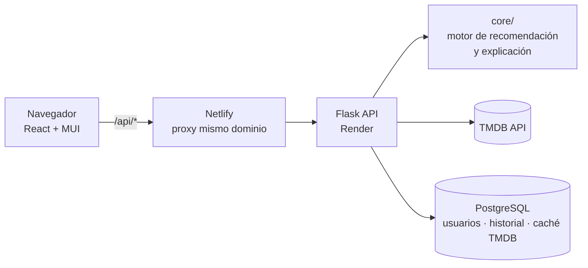

# 🎬 NEXFLIS — Recomendador de películas explicable con Recuperación de la Información

> **Proyecto académico demostrativo** de la materia *Recuperación de la Información*.
> Su propósito es **aplicar, de forma visible e interpretable, los modelos clásicos de RI** —booleano, probabilístico (BM25) y vectorial por dimensiones— dentro de una aplicación web completa tipo streaming. No pretende competir con un recomendador de producción: busca que cada decisión del ranking pueda **explicarse**.


**Autor:** Adolfo Huerta Martínez · **Reporte técnico completo:** [`docs/Reporte-NEXFLIS.pdf`](docs/Reporte-NEXFLIS.pdf)

---

## ¿Qué hace?

El usuario busca una película, la "ve" y reacciona (👍 / 👍👍 / 👎). Con eso NEXFLIS:

1. **Recupera candidatos** con un modelo de RI (booleano para filtros, BM25 para relevancia textual).
2. **Los puntúa** con una función ponderada de 8 dimensiones.
3. **Explica cada recomendación**: qué reparto, géneros, saga o temática la justifican y cuánto pesó cada señal.
4. Si la reacción es negativa, activa el modo **"Algo diferente"**, que premia la *novedad* en las dimensiones que el usuario eligió cambiar.

## Modelos de RI implementados

| Modelo / técnica | Qué hace en NEXFLIS | Dónde está |
|---|---|---|
| **Booleano** (AND / OR / NOT) | Búsqueda por facetas: género, keyword, actor, director y colección combinables con lógica booleana (`POST /api/hero/search`). | [`services/tmdb_service.py`](services/tmdb_service.py) → `discover_with_filters`, `_or_search`, `_not_search`, `hero_search` |
| **Probabilístico — BM25** | Reordena candidatos contra una consulta derivada del historial reciente (título, sinopsis, géneros, keywords). `k1=1.5`, `b=0.75`. Se mezcla con la señal base: `0.6·base + 0.4·BM25`. | [`services/tmdb_service.py`](services/tmdb_service.py) → `_bm25_scores`, `recommend_from_history` |
| **Vectorial por dimensiones** | Cada candidata es un vector de 8 similitudes normalizadas, ponderadas y sumadas. | [`core/motor_recomendacion.py`](core/motor_recomendacion.py) → `evaluar_matriz_recomendacion` |
| **Jaccard ponderado por IDF** | Los términos raros (un actor poco frecuente) pesan más que los comunes (género "Drama"). El IDF se calcula sobre el historial del usuario. | [`core/gestor_dimensiones.py`](core/gestor_dimensiones.py) → `weighted_jaccard`, `idf_from_history` |
| **Matriz documento-término** | Documento = película candidata, consulta = perfil del usuario, celda = similitud ponderada por dimensión. | `ir_tecnicas` en la respuesta de `/api/recomendar` |
| **Árbol binario de recomendación** | Rama izquierda *depth* (mismo género), rama derecha *exploration* (géneros vecinos en un grafo de transiciones). | `construir_arbol` en [`core/motor_recomendacion.py`](core/motor_recomendacion.py) |

### Función de evaluación (modo "Similar")

```
score(d) = 0.15·Reparto + 0.10·Saga + 0.15·Géneros + 0.05·Director
         + 0.20·Semántica + 0.10·Intención temática
         + 0.15·Reacción + 0.10·Tiempo visto
```

- **Semántica** = `0.45·Jaccard-IDF(keywords) + 0.35·Jaccard(sinopsis) + 0.20·Jaccard(título)`
- Se agrega sobre todo el historial con un **promedio robusto top-2** (`0.65·mejor + 0.35·segundo`) para no depender de una sola película.

### Modo "Algo diferente" (descubrimiento)

Pondera la *diferencia* en géneros, reparto, director y temática (20 % c/u), época (10 %) y calificación (10 %). Las dimensiones que el usuario marca en el modal de preferencias **duplican su peso**.

### Score de exploración (rama derecha del árbol)

```
score_exp = 0.5·score_depth + 0.3·peso_transición(género_origen → género_destino) + 0.2·novedad
```

## Seguridad y características de "producción"

- Autenticación con **bcrypt** + cookie de sesión **HttpOnly / SameSite=Lax / Secure** y JWT Bearer para clientes API.
- **Rate limiting** (Flask-Limiter) en login y registro, **CSRF** (Flask-WTF) en formularios, headers de seguridad HTTP.
- **Pagos simulados** (educativo, no se procesa dinero real): payload cifrado con **AES (Fernet)**, firmado con **HMAC-SHA256**, comprobante PDF verificable (`reportlab`).
- **Exportación del historial** en PDF y en **XML con cifrado campo por campo** + firma HMAC; el frontend puede descifrar y validar la firma.
- **Restricción de contenido por edad** aplicada en recomendaciones y visualización.
- Eliminación de cuenta con borrado en cascada (`ON DELETE CASCADE`).
- **Logging** centralizado con rotación de archivos.

## Arquitectura



```
core/        Motor de recomendación, explicación, gestor de dimensiones, logger
models/      Modelos: Pelicula, Usuario, Explicacion, NodoRecomendacion
routes/      Blueprints Flask: auth, búsqueda, recomendación, pagos, historial
services/    Integraciones: TMDB, PostgreSQL, auth, pagos, exportación, cifrado
frontend/    SPA React 19 + Vite + Material UI
templates/   UI Jinja2 original (primera versión, aún servida en "/")
tests/       66 pruebas (unitarias + e2e con TMDB y BD mockeados)
docs/        Reporte técnico y guía de despliegue
```

## Ejecutar en local

**Requisitos:** Python 3.12+, Node 20+, PostgreSQL (opcional: sin BD la app arranca, pero no hay usuarios ni historial) y una API key gratuita de [TMDB](https://www.themoviedb.org/settings/api).

```bash
# 1. Backend
python -m venv .venv
.venv\Scripts\activate            # Linux/Mac: source .venv/bin/activate
pip install -r requirements.txt
cp .env.example .env              # completa TMDB_API_KEY, DATABASE_URL y los secretos
python app.py                     # http://localhost:5000  (crea las tablas solo)

# 2. Frontend (otra terminal)
cd frontend
npm install
npm run dev                       # http://localhost:5173  (proxy a :5000)
```

### Pruebas

```bash
PYTHONPATH=. python -m unittest discover -s tests
```

## Despliegue

Frontend en **Netlify**, API en **Render** y base de datos en **Neon** (PostgreSQL gratuito). Los archivos [`netlify.toml`](netlify.toml) y [`render.yaml`](render.yaml) ya están listos; los pasos están en [`docs/DESPLIEGUE.md`](docs/DESPLIEGUE.md).

## Alcance y limitaciones (a propósito)

- Es un proyecto **demostrativo**: la prioridad es la claridad de los modelos de RI, no la escala.
- Los candidatos y metadatos vienen de **TMDB**; no hay un índice invertido propio ni corpus offline, por lo que BM25 se calcula sobre el conjunto de candidatos de cada consulta, no sobre toda la colección.
- En la barra de explicación, la técnica "BM25" se aproxima con la señal de intención temática; el BM25 real actúa en la etapa de recuperación de candidatos.
- Los pagos son **simulados**: no se almacenan números de tarjeta (solo los últimos 4 dígitos).
- El *rate limiting* usa memoria local, por lo que el despliegue corre con un solo worker.

## Créditos

Datos e imágenes: [The Movie Database (TMDB)](https://www.themoviedb.org). Este producto usa la API de TMDB pero no está avalado ni certificado por TMDB.
